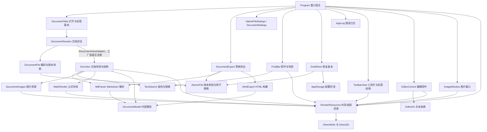

# 当前架构

## 2026-09-28 架构演进（E0–E20）

本轮按 [ADR-0001](docs/adr/0001-architecture-evolution-principles.md) 用小切片渐进演进。命令、快捷键、状态文件格式和 Markdown 读写保持兼容；有意改变行为的修复都列在 ADR-0001 第 5 条，各自在演进记录中写明了新旧差异。本节是当前状态；下面按日期排列的各节是当时的记录，其中的数字不再更新。

**分层**（从下到上）：

1. 平台：`Win32`、`Dwrite`；
2. 基础设施：配置目录、日志、恢复副本、偏好设置，如 `AppStorage`、`AppLog`、`DraftStore`、`AppPreferences`。这一层不在检查名单里；
3. 领域：
   - 内容层：`MdParser`、`DocumentModel`、`BlockText`、`MathModel`、`TextSearch` 等；
   - 工作流层：`DocumentSession`、`DocumentTabs`、`DocumentFile`、`AtomicFile`、`TextEditHistory`、`RecentList` 等；
4. 排版绘制：`DocView`、`RenderResources`、`MathRender`、`MathGlyphs` 等；
5. 宿主：`Program`、`NativeForm`、`NativeMenus`、`EditorControl`、`ToolbarView`、`FindBar` 等。

**规则**：
- 内容层和工作流层不得引用排版绘制层和宿主层，直接引用和经其他模块中转的间接引用都不行；
- 模块之间没有循环，只有两处长期接受的例外：`MathUnicode ↔ MathSyntax`、`UndoBudget ↔ TextEditHistory`；
- 这两条由 `selftest/DependencyRulesTests.cs` 检查。文件开头的名单是分层的唯一来源，没列入名单的模块不必定层，但不能充当中转；
- 工作流层只通过 `IDocumentViewAdapter` 使用视图。具体的 `DocViewAdapter` 和视图工厂在宿主侧的 `DocumentViewAccess`，程序集加载时注册；宿主经 `session.Doc` 拿到 `DocView`；
- 单项目、单命名空间，`engine/` 保持平铺（ADR-0001 第 6 条）。

**规模**（`0100de8` 时）：
- `engine/` 共 121 个 C# 文件、23,591 行；
- `Program` 共 7 个分部文件、3,215 行，主文件 1,827 行。`WndProcInner` 是 78 行的分派表，有 16 个 `case`，按消息族转发到 `Program.Pointer`、`Program.Viewport`、`Program.Commands`、`Program.Lifecycle` 等分部文件；
- `DocView` 共 4 个分部文件、3,719 行，主文件 3,460 行。`Build` 约 580 行、`Paint` 约 450 行，都直接调用 DirectWrite 和 D2D，改到相关功能时再抽。

**本轮新增或调整的接缝**：
- `LayoutCache<TEntry>` 经 `LayoutCacheBudget.IView` 与视图解耦（E18a）；
- `BlockText` 集中管理块的阅读态文本（E18b）；
- `AppConfig` 负责 `config.txt` 的解析和写回（E8）；
- HTML 导出默认使用白名单过滤（E14、[ADR-0002](docs/adr/0002-html-export-allowlist.md)）。

**测试基线**（E26 时）：quick 自测 2,853 项；只靠投递消息的 11 个窗口测试共 184 项；提交前跑一次 `build.ps1 -Task Verify -Performance`。

## 2026-09-19 至 09-21 架构收敛批次

以下对象从 `Program`、`DocumentSession` 与 `DocView` 中抽出，均为职责搬迁而非行为变更：

- `CommandDispatcher`：加速键 1001–1016 的命令到动作映射；宿主经 `CommandDispatchContext` 提供动作，分派仍发生在 `WM_COMMAND` 中原位置。
- `ProductCommandDispatcher`：产品命令 2200–2299 的映射，含异常报告与命令后刷新；`HasComposition` 门禁与对话框仍归宿主。
- `CmdGate`：`RequiresStableText` / `RequiresWritable` 改由每个 `CmdDef` 的 `Gate` 声明，不再按数字区间推断；非菜单的控件协议命令（最近文档 2100–2104、查找栏 3001–3023、Ctrl+Tab）在 `Commands.AuxiliaryGates` 显式登记。
- `IDocumentViewAdapter` / `DocViewAdapter`：`DocumentSession` 只通过该接缝加载、排版和释放视图。会话构造不再创建 `DocView`，空白标签保持无视图，直到文档加载或首次读取 `Doc` 才按需实体化；宿主用 `AttachView` / `DetachView` 移交渲染生命周期，`HasView` / `ViewAdapter` 用于查询。`DocumentTabs` 接受会话工厂。
- `WindowChrome`：窗口主题与镶边族的纯算术——标题栏/边框/文字色表、沉浸式暗色标识、滚动条主题名与激活判定；DWM 与 Win32 调用留在宿主。
- `WindowLifecycle`：生命周期纯函数——关窗前脏状态汇总与退出阻断、文件拖放分类（`DropKind`）、异常销毁的草稿检查点决策、上下文菜单锚点与命中判定；消息循环、窗口销毁与弹窗留在宿主。
- `WindowGeometry`：窗口尺寸与 DPI 纯算术——最小尺寸、DPI 换算、尺寸解包、拖拽取消自适应、越界吸附、宽度自适应与重绘带区。
- `AppState`：`Program` 的窗口级交互状态聚合——编辑态、基准字号、自适应宽度、窗口初始边界配置、提示计数与生命周期过渡标记；`Program` 内 18 个静态字段改为转发到它的属性。
- `PointerSession`：指针选区状态机——按下/拖拽/释放、自动滚动方向、悬停与按压按钮、释放意图分类（`PointerClickIntent`）。
- `ToolbarView`：工具栏与标签的绘制及命中——按钮/标签/溢出命中、焦点环激活与步进；`Program` 的 `WM_SETCURSOR` 光标判定与工具栏焦点移动改为调用它。
- `LayoutCache`：`DocView` 的根布局 LRU（512 条）与 `LayoutCacheBudget` 登记；`DocView` 保留 `GetEnt` 入口。
- `HitTestingGeometry`：`BlockAtY` 的二分与就近修正，纯函数；`PosAt`、表格与 DirectWrite 命中仍在 `DocView`。
- `ScrollGeometry` / `SmoothScroll`：滚动族的算术与滚轮缓出状态机——像素网格量化、滚动上限、滚动条与翻页键共用的命令表、22% 缓出与 120 DIP 封顶、拖拽边缘带、`SCROLLINFO` 换算。宿主保留定时器、`SetScrollInfo` 与正文条带失效；`WM_VSCROLL`、`WM_MOUSEWHEEL`、`TIMER_SMOOTH` 与翻页键分支收缩为取数、调用、施加副作用。

`Program.cs`（2253 行）与 `DocView.cs`（3070 行）仍是主要协调点（当时的数字，现状见上方 2026-09-28 一节），`WndProcInner` 一个函数仍含 31 个 `WM_*` 分支。

## 2026-09-18 源码编辑控件更新

源码编辑区已由系统 EDIT 迁移到 `RICHEDIT50W`。`EditorControl.RichText.cs` 管理系统模块、TOM 接口、纯文本流与延迟着色；`EditorCoordinates` 将原生 CR 位置转换为宿主继续使用的 UTF-16/CRLF 位置。`MarkdownSourceColors` 只产生有界词法颜色区间，不参与预览解析或修改源文。行号读取原生字符坐标，格式化不移动选区、不进入撤销历史。下方旧阶段中关于 EDIT 的记录保留为历史。

## 模块边界

- `Program` 处理主窗口 HWND、消息分发与界面协调，决定何时打开、保存、切换、恢复文档及显示控件。EDIT 的子类回调和字体归 `EditorControl`，图片窗口的消息和位图引用归 `ImageWindow`，共享绘图资源归 `RenderResources`。
- `DocumentTabs` 管理活动索引与会话所有权。`TryOpen` 先读取并预布局候选文档，再准备旧会话；新增/复用标签保留草稿，替换现有会话才调用保存/放弃守卫。取消或失败时释放候选文档，保留原会话。相同完整路径按 Windows 大小写规则复用标签。关闭最后一个标签补一个空会话；窗口退出只释放，不补建。
- `DocumentSession` 持有路径、源文本快照、保存快照、磁盘版本、编码、换行、脏状态和滚动位置，并通过 `IDocumentViewAdapter` 持有视图，本身不引用 `DocView`（E19a）。写盘成功后才提交新路径、内容与版本。
- `DocumentFile` 负责严格 UTF-8/BOM/GBK 检测、编码和 EDIT 换行转换。读取拒绝有损解码，保存拒绝 GBK 无法表达的字符。
- `AtomicFile` 的 `Write` 为文档保存和 HTML 导出提供版本校验、原子替换与 `.bak` 备份；`WriteState` 为配置和恢复副本提供目录创建及覆盖写入。两者共用私有 `Commit`，统一同目录临时文件、刷新和清理，保留各自的冲突与备份语义。
- `DocumentExport` 从显式传入的当前草稿构建独立 HTML 快照，捕获目标版本。覆盖确认取消时不写盘，导出不会修改源文档的保存快照或脏状态。
- `NativeFileDialogs` 只负责选择路径及 COM/字符串资源释放；`DocumentDialogs` 只返回保存、放弃、另存、覆盖或取消的决策，不修改会话。宿主收到决策后同步文档与 EDIT。
- `FindBar` 是窗口持有的实例，经 `IFindHost` 获取活动文档、编辑控件及视口；拥有查找/替换 HWND、标签、原生按钮、输入回调、GDI 字体及 DWrite 按钮文字布局。它报告占用高度，由宿主统一放置内容区域；按钮通过原生 `WM_COMMAND`、`WM_DRAWITEM` 接入导航和主题。键盘预处理在 `TranslateMessage` 前完成，避免重复字符影响命令；输入回调异常进入统一日志。DPI 变化更新控件字体。
- `MdParser.Parse` 每次创建独立 `ParserContext`；引用链接、脚注、引用运行序号及解析预算均属于当前解析，嵌套解析共享该实例，跨文档解析互不共享可变状态。
- `DraftStore` 只负责有版本的恢复快照持久化，宿主负责定时采集实时文本、询问恢复、保存或放弃后的清理。`DocumentSession` 负责捕获/恢复快照，`DocumentTabs` 在加载和布局成功后才提交恢复标签。
- `AppStorage` 只统一配置目录；`AppLog` 记录带时间、操作与异常堆栈的日志并轮换。内部状态写入复用 `AtomicFile.WriteState`。
- `Win32.cs` 中的 `Externs` 和 `Clipboard` 是共用原生声明的归属处；宿主、查找栏和文档视图直接复用。`Externs.WindowText` / `EditSelection` 统一读取控件文本和 EDIT 选区，`FindBar` 不再维护自己的 P/Invoke 声明。
- `TextSearch` / `SearchOptions` 统一预览和编辑的匹配、计数、导航及单次/全部替换；默认不区分大小写的 Ordinal 比较，可选大小写和 Unicode 整词边界，替换仍按字面处理。
- `NavigationHistory` 只保存会话身份、路径与逻辑阅读位置，有限容量、成功后提交，不延长文档或窗口生命周期；窗口宿主负责激活/重开及网络路径确认。
- `CodeBlockTargets` 将绘制命中区域、共享文本偏移与代码原文联系起来；每帧/重排清理，不复用过时命中，不在绘制时重新构建代码字符串。
- `ImeComposition` 为源码和查找/替换输入提供原生组合状态；`Commands.RequiresStableText` 统一操作闸门，避免 Enter/Escape/Tab 被应用抢走。组合期间延迟跨实例队列和活动草稿检查点。
- `NativeMenus` 复用菜单声明；`Clipboard` 在清空剪贴板前准备内存，并将实际窗口作为所有者。代码内容 Tab 保真由解析阶段区分结构缩进和字面内容完成。
- `DocView` 负责文档块布局、绘制、选择和命中，拥有布局缓存与几何状态。最近文件和内容区域顶部经 `Paint` 参数显式传入；空页悬停属于当前视图。查找条独立绘制，不再作为文档覆盖层。
- `DocumentModel` 定义解析、预览、导出共用的 `Block` / `Run` 内容模型。块高度存入 `DocView` 的视图数组，表头字体权重作为布局参数传入，避免排版改写解析结果。当前模型仍可变，不宣称为不可变 AST。
- `RenderResources` 持有共享 D2D 渲染目标、DWrite 工厂与格式、主题刷、字符测宽缓存和控件背景刷。应用入口的资源作用域在全部视图与控件关闭后释放；只允许一个活动作用域。图片、公式与工具栏直接复用它，不再经 `DocView` 获取绘图资源。
- `EditorControl` 持有系统 EDIT、子类回调 GCHandle、DPI 字体、行号布局缓存；宿主注入文本变更和粘贴图片动作，保存与文档身份仍由宿主协调。缩进和列表续行共用现有 `EditorKit`，不另建文本编辑引擎。
- `ImageWindow` 持有图片查看 HWND、位图引用、缩放、平移和提示计时器。打开只接收宿主句柄和图片参数，可独立关闭与重开，不依赖文档会话或 `DocView`。
- `ToolbarView` 由窗口持有，接收 `CmdState` 和标签快照，拥有文字布局、原生提示框和命中区域。隐藏标签保留原文档索引，宿主通过 `HitTab` 获取切换或关闭目标，溢出列表沿用原生菜单。标签移除或改名时释放旧标题布局，关闭窗口时统一释放。目录和标签共用 `Dw.TrimLayout`，按 Unicode 文本元素边界添加省略号。

## 文本与编辑状态

预览、重新进入编辑、非活动标签保存的内容依据是文档会话。系统 EDIT 仅在编辑模式下持有当前文档的即时草稿，宿主保存时显式读取并传入会话。隐藏的 EDIT 不再作为源文本来源。

`EditorSession` 将窗口持有的单个 `EditorControl` 绑定到活动会话，不拥有文档或 HWND。会话内存中的 `EditorPosition` 保存原生 EDIT 的 UTF-16 选区和首可见字符位置；它不是完整 AST 源码映射，也不跨进程持久化。向 EDIT 写入会话内容时，用 `_syncingEditor` 抑制程序化文本同步产生的脏通知。相同会话且内容相等时不回填全文，同文档往返预览及保存不会因此清空原生撤销；跨标签回填保留位置，不承诺转移原生撤销栈。编辑区统一使用 CRLF，写盘转换回原文件换行风格；转换是幂等的，不再累积 `CRCRLF`。

编辑切到预览先通过 `EditorSession.PreviewDraft` 将实时文本发布到当前会话和视图，保留保存快照、磁盘版本与恢复身份，不写源文件。预览准备失败时保持 EDIT 可见；撤销回已保存内容后清理过时恢复副本。切换标签保留草稿和编辑位置，不自动保存或放弃；关闭和替换仍执行原有保护。每个会话直接保存阅读滚动位置，宿主不再持有第二份活动标签滚动副本。

打开对话框先选择文件，再经统一的 `LoadFile → DocumentTabs.TryOpen` 路径读取、预布局和准备旧会话；仅会替换旧文档时确认草稿。最近文件、文档链接、拖放和单实例转交使用同一路径。取消文件选择不会先放弃修改；读取失败不会触发旧草稿守卫。确认放弃时同时恢复会话、EDIT 和标题；重复打开活动路径保留编辑区内容、选区和撤销记录。

列表续行与块缩进以文本中的 LF/CRLF 为源码行边界，避免把 EDIT 视觉折行或 16 位行缓冲当成 Markdown 行。Shift+Tab 的选区端点按实际删除的缩进映射，替换仍使用原生可撤销消息。文本变换在 `WM_CHAR` 处理；`TranslateMessage` 生成字符后不会再次由默认 EDIT 重复插入换行或 Tab。Shift+Enter 保持原生换行行为。

查找输入清空时清除预览高亮。预览与编辑切换时刷新查询与替换栏显隐；全部替换使用 EDIT 的可撤销文本替换消息。

## 草稿恢复

宿主在首次修改后注册 2 秒定时器，后续输入不重置计时，因此连续输入也能产生副本。定时器从活动 EDIT 读取实时文本，其他脏标签从各自会话采集；没有新修改时不重复写盘，相同快照不重复提交。写入在 UI 线程进行，繁忙消息循环会延后快照，不能保证最后约 2 秒输入已经持久化。

每个会话具有独立恢复 ID。JSON 快照使用 System.Text.Json 源生成元数据，支持 NativeAOT；包含 schema、路径、即时草稿、保存快照、原始磁盘 SHA-256、编码及换行风格。同目录私有临时文件刷新后原子替换正式副本；失败保留上一份完整记录。未完成提交的临时文件不会被当作有效草稿载入。

重启先读取副本，再由用户选择是否恢复。恢复是标签事务，不写源文件；同一路径已打开的干净标签可被恢复草稿替换，有活跃草稿则拒绝替换并保留记录。未命名草稿各有独立身份。恢复后的会话仍是脏状态，保存仍使用副本内的旧磁盘版本，不能拿启动时读到的外部版本为旧草稿背书。

成功保存、明确放弃或确认关闭后只清理相应恢复 ID。未恢复的副本不会被正常退出清空。损坏记录保留为 `.corrupt-*` 并记录错误，不阻止其他副本；无法识别的格式版本保留供对应应用版本处理。副本和日志遵循 `MDV_CONFIG_DIR`，默认与配置同在用户 AppData 下；日志保留当前文件和一份轮换文件。日志写入失败不会再抛出异常。

## 文件版本与冲突

`FileVersion` 用原始文件字节的 SHA-256 标识版本，读取内容和版本来自同一份字节，因此时间戳相同、长度相同的外部修改也能被发现。文件不存在是明确的版本状态。

写入先生成并刷新私有临时文件，再在替换前校验目标版本。普通保存使用会话上次读取或保存的版本；另存为默认只允许新建。已有目标先记录版本再询问覆盖，用户确认只对该版本有效。冲突时保留草稿和会话身份，提供取消、另存为副本、明确覆盖三种选择。确认期间再次修改会重新触发冲突。成功替换保留单级 `.bak`，失败不轮换备份。

这是乐观冲突检测；版本校验与 Windows `File.Replace` 不是跨进程的原子比较交换。其他程序若恰好在最后校验与替换之间写入，仍存在很短的竞争窗口。路径复用按规范化完整路径进行，不合并硬链接或符号链接的不同别名。

## 资源与布局失效

| 资源 | 所有者 | 释放时机 |
|---|---|---|
| 文档文字、代码、公式、表格布局 | `DocView` | 缓存淘汰、重排、文档关闭 |
| 目录文字布局 | `DocView` | 重排、文档关闭 |
| 图片位图 | `DocumentImages` | 文档重新载入、文档关闭 |
| 图片查看 HWND、独立位图引用、GCHandle、提示计时器 | `ImageWindow` | 图片窗口关闭；原文档可以先关闭 |
| 系统 EDIT、回调 GCHandle、GDI 字体、行号布局 | `EditorControl` | DPI/格式失效时释放旧缓存，控件或父窗口销毁时释放全部 |
| 查找 HWND、输入回调 GCHandle、字体、按钮布局 | `FindBar` | 窗口销毁，释放幂等 |
| 工具栏、标签标题布局、原生提示框及文本缓冲 | `ToolbarView` | 标题失效、窗口关闭 |
| DWrite 工厂、D2D 渲染目标、主题刷、共享文字格式及控件背景刷 | `RenderResources` | 应用作用域结束，晚于文档和控件释放 |
| 快捷键加速表 | `Program.Main` | 消息循环结束的 `finally` |

`DocView` 实现幂等 `Dispose`。GC 不负责释放裸 COM 指针，载入文件时不再通过强制全代 GC 代替资源管理。

应用与自测入口显式声明 STA，并用 `ComApartment` 配对初始化和释放 UI 线程的 COM 环境。打开/另存对话框不再依赖“先解码过一张图片”才能正常工作。`NativeFileDialogs` 在所有返回和异常路径释放对话框、ShellItem 和字符串；原生确认对话框的结构布局按 Windows SDK 声明。

字体格式重建会递增全局排版版本并清除字符测宽缓存；编辑控件在下一次行号绘制时释放过期布局。各 `DocView` 记录自身完成布局时的版本；切回标签时，即使窗口宽度没变，也会刷新过期布局。正文列宽在重排时按当前字号重新计算。

`SetBodySize(..., relayout: false)` 仅更新格式与失效版本。宿主可以让同步 `WM_SIZE` 完成重排，随后调用幂等的 `EnsureLayout()` 兜底。固定窗口、最大化和编辑模式也有明确的刷新路径。`LayoutPassCount` 用于验证一次操作实际完成的重排次数。

表格测量与绘制共用 `GetEnt` 的布局缓存，删除重复的 `BuildTableMeasure`；高度仍由视图保留，缓存淘汰后只需按需重建可绘制布局。布局、绘制和命中读取同一套几何与缓存，当前不再人为拆开。

原生 shim 成功创建渲染目标后释放工厂的创建引用，目标自身持有工厂；图片窗口的每次绘制配对 `BeginDraw` / `EndDraw`。资源作用域的重复释放、顺序重建与原生 COM 引用归零已有回归检查。

## 验证与基线

`selftest/ArchitectureTests.cs` 覆盖延迟重排、多标签字体变更、COM 引用计数、文件逐字节往返、写盘失败、标签取消/关闭、图片归属、工具栏缓存释放、完整按键消息序列、编辑控件 DPI/销毁及表格布局前后的导出一致性。

`selftest/HostSmoke.ps1` 使用真实 Win32 消息操作普通构建或 NativeAOT 产物，覆盖编辑保存、光标保持、取消切换、切换时保存、固定窗口字号刷新、放弃草稿、经真实消息循环的长列表续行，以及图片窗口像素、缩放、拖动和关闭流程。配置写入独立临时目录，已有用户进程不会被终止。

`selftest/DocumentWorkflowTests.cs` 补充文件冲突、确认期间再次修改、外部删除、另存目标保护、非法编码、草稿导出、取消覆盖、打开事务、路径复用与搜索语义测试。

`selftest/HostFileSmoke.ps1` 覆盖纯文本文档上的原生打开/另存对话框、两阶段取消、读取失败、冲突取消/另存/覆盖、导出覆盖确认、活动草稿导出和替换撤销。与 `HostSmoke.ps1` 共用 `HostTestSupport.ps1`，支持 PowerShell 5.1/7。导出成功提示保持打开直到结束自有测试进程，避免启动用户浏览器；原有宿主测试单独验证正常退出。

2026-09-14 校验发现：版本 `6531644` 的源码本身已与旧语料清单中的六个结构哈希不符。本轮从该版本单独构建自测程序，逐字节确认六份结构输出与修改后程序完全相同，才更新清单的结构哈希。断行哈希、行数、文档高度保持原值。`rec.ps1` 同时修正了 PowerShell 7 的路径传参，并检查子进程退出码。

第一轮治理的验证记录：

- 自测 351 项通过，其中新增架构回归 45 项。旧实现上的延迟重排、旧标签字体刷新和原生布局释放三项先复现失败，再验证修复。
- NativeAOT 发布成功，真实窗口交互 15 项通过。
- 浅色预览、浅色目录、深色目录、深色编辑四张客户区截图与原基线逐像素一致。
- CommonMark 项目口径保持严格 554/655、宽松 609/655；语料清单通过。
- 最后一次性能测量：20k 行 1204ms、完整语料 11ms，满足现有 1250ms/40ms 门槛。
- 普通构建仍有 6 个既有未使用字段警告；NativeAOT 仍有既有 `Marshal.GetHINSTANCE` 的 IL3002 警告。真实 AOT 窗口测试已通过，警告清理未混入本轮变更。

本次文件流程与架构治理后的验证结果：

- 自测 382 项全部通过，比第一轮新增 31 项。
- NativeAOT 发布成功；发布产物的原有 15 项窗口测试和新增 16 项文件流程测试通过。
- 四张客户区截图与原基线逐像素一致，截图位于 `work/workflow-ui-final/`。
- CommonMark 保持严格 554/655、宽松 609/655；语料清单通过，没有刷新基线。
- 性能：20k 行 1121ms、完整语料 11ms，通过 1250ms/40ms 门槛。
- 普通构建剩余 4 个既有字段警告；AOT 保留既有 `Marshal.GetHINSTANCE` 的 IL3002 警告。该 API 的替换未混入本次文件行为修复。

## 可迁移构建与持续验证

`build.ps1` 是 Build / Verify / Publish 的唯一正式入口，脚本按自身位置定位项目；支持中文及空格路径、从其他工作目录调用，兼容 PowerShell 5.1 / 7。`scripts/BuildNative.ps1` 自动发现 x64 C++ 工具链，将原生中间文件输出到 artifacts，供两个项目经 `NativeShimPath` 属性引用。导入 vcvars 后清除它设置的 `Platform` 环境变量，避免 managed bin/obj 悄悄转到 x64 子目录，导致测试运行旧程序或干净检出失败。

`global.json` 固定 SDK feature band 并允许补丁更新；`Directory.Build.props` 启用托管确定性构建。Verify 执行格式、自测、逐例规范和语料检查；Publish 在这些检查通过后编译 AOT 并打包两份运行文件。UI 和性能验收是显式选项，不在无交互桌面或不同硬件条件下冒充已经验证。

规范基线由重构前的 554/655 严格、609/655 宽松实现建立，记录全部 655 个样例及规范文本哈希；后续没有重录。`--spec-verify` 要求逐例状态一致，总分相同的样例退化也会失败；改进也需要显式审查基线变更。GitHub Actions 在 Windows runner 上运行 Publish 并上传候选包，远端工作流尚未实际触发。

## 本轮工程治理验证

2026-09-14，本轮统一入口 `build.ps1 -Task Publish -Ui` 完整通过：

- 自测 401 项通过，其中新增 17 项恢复/日志检查、2 项解析隔离检查。
- 并行解析检查在旧实现上先复现 240 次解析中 213 次异常输出；隔离上下文后同一测试 240 次全部一致。
- 真实 NativeAOT 窗口检查 49 项通过：宿主 16 项、文件与查找 20 项、崩溃恢复 13 项。恢复测试实际强制终止自有进程，并验证重启、暂缓恢复、未命名草稿、外部修改冲突及副本清理。
- 逐例规范基线保持严格 554/655、宽松 609/655；规范和语料均未重录。额外交换两个样例的 strict/loose 状态、保持总分不变，验证命令正确返回退出码 1。
- 性能验收：20k 行 1056ms、完整语料 11ms，通过现有 1250ms/40ms 门槛。
- 三张预览客户区截图与旧基线逐像素相同。编辑截图仅有 134 个滚动条像素变化；同一 397 行文档上，旧 AOT 程序报告 page=0，新程序报告 page=41。原因是将无效的 `Marshal.GetHINSTANCE` 替换为 `GetModuleHandleW(null)`，恢复了实际可见页大小。新增窗口检查覆盖这一行为；旧图像基线保留供审查。
- 本机 PowerShell 5.1 和 7 均验证通过；复制完整工程到含中文、空格的新目录，再从其他工作目录调用统一入口，Verify 通过。干净复制不包含原有 bin/obj 或本机 NuGet 缓存。
- AOT 发布成功，原有 IL3002 模块句柄警告已消除，剩余 4 个既有字段警告。可执行程序为 4,885,504 字节，原生 DLL 为 103,936 字节；压缩包仅包含这两份运行文件，已检查完整性。
- GitHub Actions 配置已添加，未推送、未触发远端运行。本机通过不等同于远端 CI 已通过。

本轮可复查产物：`artifacts/MDViewerNative-win-x64.zip`、`artifacts/ui/`；详细本机日志为 `work/engineering-verified.log`，性能在 `work/engineering-final.log`，迁移检查在 `work/relocation-final.log`。这些临时产物不纳入版本控制。

## 复用与规范收敛

2026-09-14，针对重复实现和代码持续增长做了以下收敛：

- 15 组同名重复原生声明归并到现有 `Externs` / `Clipboard`；两份控件文本及 EDIT 选区辅助实现各保留一份。没有新增业务模块。
- 文档、导出、配置、恢复共用 `AtomicFile` 的临时文件提交机制，删除 `AppStorage.Write` 的重复实现。
- 删除四个从未赋值或使用的字段，以及图片导出中永不生效的宽度分支。C++ 构建显式使用 `/utf-8`，消除源码编码警告。
- 自测以 `ProjectReference` 和 `InternalsVisibleTo` 测试真实生产程序集，删除 28 项手工源码链接清单。本轮未新增测试用例。
- 格式检查接入 Verify / Publish，因此本机与 CI 使用同一门槛。在隔离副本上运行正式 Verify，旧格式触发 formatter 退出码 2、构建脚本退出码 1；修复后的源码通过检查。

统计以本轮开始时的 `work/reuse-before/` 为准，未计入此前已删除的计划文档。生产仍为 32 个 C# 文件：原始行数 11,434 → 11,461，净增 27 行；将起点副本按相同格式规则排版后为 11,497 行，对齐格式后净减 36 行。非空白字符 319,110 → 318,069，减少 1,041。自测 C# 保持 2,236 行。这里的行数包含空行和注释，不能等同于复杂度下降；实际减少的是重复声明、重复写盘机制和另一份编译源文件清单。

最终 `powershell -File ./build.ps1 -Task Publish -Ui -Performance` 完整通过：

- 生产与自测构建均为 0 警告、0 错误；NativeAOT 无编译警告。
- 原有 401 项自测、49 项真实 AOT 窗口检查全部通过。
- 655 例逐例规范基线与语料清单通过，没有重录；严格 554/655、宽松 609/655 保持。
- 20k 行整体解析与布局 1083ms、全格式文档 10ms，通过 1250ms / 40ms 门槛。
- 四张客户区截图与本轮开始前的发布产物逐像素一致，包括上一轮已修复的编辑器滚动条。
- AOT 程序 4,883,456 B，原生 DLL 103,936 B，压缩包 2,525,270 B。已验证压缩包只含这两文件、CRC 正确且内容与发布目录一致。

本机日志为 `work/reuse-final.log`，格式反例日志为 `work/reuse-format-negative.log`，代码量记录为 `work/reuse-metrics.json`，截图与压缩包检查为 `work/reuse-artifact-check.json`。远端 CI 未触发。Markdig 的 AOT、规范、性能和适配评估见 [PARSER-EVALUATION.md](PARSER-EVALUATION.md)；本轮未向生产添加解析依赖，评估程序仅保存在被忽略的实验目录。

## 绘图与控件边界收敛

2026-09-14，以本轮开始的 `work/architecture-before/` 为起点，收拢共享绘图资源、编辑控件、图片窗口和内容模型；未引入生产依赖，未改动规范或语料基线。

| 项目 | 本轮开始 | 本轮完成 |
|---|---:|---:|
| 生产 C# 文件 | 32 | 36 |
| 生产 C# 行数（含空行和注释） | 11,461 | 11,499 |
| 生产非空白字符 | 318,069 | 318,370 |
| `Program.cs` 行数 | 2,158 | 1,824 |
| `DocView.cs` 行数 | 3,094 | 2,530 |
| `MdParser.cs` 行数 | 2,131 | 2,093 |
| 自测 C# 行数 | 2,236 | 2,372 |
| 窗口测试 PowerShell 行数 | 536 | 619 |

四个新增生产文件分别为 `RenderResources`（420 行）、`EditorControl`（274 行）、`ImageWindow`（186 行）、`DocumentModel`（42 行），主要来自职责迁移。删除重复表格测量、原生行缓冲辅助、控件配色和不再使用的状态后，生产净增 **38 行**、非空白字符净增 301；回归 C# 净增 136 行，窗口测试净增 83 行。未把此前已删除的计划文档算作本轮减法，也未用大文件缩短代替总量核算。

Roslyn 对生产 C# 文件的语义引用扫描中，原 `DocView / DocumentImages / MathRender` 循环已消除，当前未发现文件之间的循环依赖；引用 `DocView` 的文件由 6 个减到 3 个，剩 `Program / DocumentSession / FindBar`。扫描用于检查显式源码引用，不覆盖运行时回调或生成代码，不代表完整运行时依赖证明。同名 `extern` 声明重复组保持为 0。

最终正式入口 `powershell -File ./build.ps1 -Task Publish -Ui -Performance` 完整通过：

- 生产与自测构建均为 0 警告、0 错误；NativeAOT 发布无编译警告。
- **419 项自测通过**。比起点净增 18 项：新增 19 项行为与资源检查，删除 1 项只搜索宿主源代码字符串的上下文菜单检查，改以真实控件消息验证。
- 补齐 `WM_KEYDOWN → WM_CHAR → WM_KEYUP` 后，修复前有 5 项编辑检查失败；将文本变换移入字符消息后全部通过。真实 AOT 窗口的两个列表检查使用 `PostMessage`，实际经过宿主的 `TranslateMessage`。
- 两批各 20 次编辑控件创建、DPI 切换和销毁，GDI 对象数保持 2 → 2；工厂额外测试引用在资源作用域结束后释放至 0。
- **57 项真实 AOT 窗口检查通过**：宿主 24、文件与查找 20、崩溃恢复 13。图片窗口新增实际绘制、缩放、拖动、Esc 与失焦关闭检查。
- CommonMark 逐例基线通过，项目口径保持严格 554/655、宽松 609/655；语料清单通过，两类基线均未重录。
- 20k 行解析与布局 **1076ms**、全格式语料 **10ms**，通过既有 1250ms / 40ms 门槛。
- 四张原客户区截图与本轮起点逐像素一致；第五张为新增图片窗口验证图。
- AOT 程序 **4,882,432 B**、原生 DLL **103,936 B**、压缩包 **2,525,231 B**。已检查包内恰含两份运行文件、CRC 正确且内容与发布目录一致。

本轮复查记录为 `work/architecture-final.log`、`work/architecture-keyboard-negative.log`、`work/architecture-metrics.json`、`work/architecture-dependency-check.json`、`work/architecture-artifact-check.json`。依赖分析工具和起点副本只用于本机实验，未加入生产构建。发布包和截图位于 `artifacts/`，未提交或触发远端 CI。

## 界面与交互完善

2026-09-14，在 `work/ui-before/` 保存本轮起点，以实际窗口中的多标签遮挡、标题裁切和编辑态查找覆盖为改动依据，保留现有阅读配色及内容排版。

- 工具栏从 22 → 36 DIP，按钮内容高度约 28 DIP。标签与命令区域分开计算；可见标签维持可读宽度，当前文档优先显示，其余文档进入溢出菜单。关闭图标使用真实斜线，非活动标签使用次要文字色，文件名通过原生提示框补全。
- 查找区固定在工具栏下面，查找占 44 DIP，编辑态替换占 80 DIP。`Program.ContentTop / ContentHeight` 统一参与预览绘制、编辑 HWND 放置、滚动范围、图片/文字/目录命中；`DocView` 自身排版不依赖工具栏高度。删除原浮动卡片几何、鼠标按钮命中和覆盖层回调。
- 查找上一处、下一处、关闭、替换与全部替换采用原生可聚焦按钮；只自绘外观，保留原生命令与键盘行为。输入区带标签、边框、提示及计数。重复 Ctrl+F 保留当前位置，切换回查询无需重新开始查找。
- F6 在工具栏和正文间切换；工具栏支持方向键、Tab、Enter、Space 与 Esc。查找条支持 Tab、Enter、Esc，完整按键从宿主消息循环验证。
- 编辑默认字号 14 → 16 DIP，缩放与阅读字号联动，保留选区、内容及原生撤销。编辑 HWND 内保留 8 DIP 留白；系统主题变更重置格式矩形后，控件会重新绑定字体和内边距。行号不再画到文档末尾之后。
- 目录保留用户的打开偏好，在客户区不足 620 DIP 时折叠，拉宽后恢复。手动窄窗及编辑态禁用目录操作；自动适配的阅读窗口仍允许打开目录并扩宽。当前采用自动折叠，没有增加可拖动侧栏宽度或目录树折叠功能。

最终 `powershell -File ./build.ps1 -Task Publish -Ui -Performance` 完整通过：

- 426 项自测通过：比起点净增 7 项，新增 8 项导航、缩放与主题行为检查，删除 1 项已移除的浮动查找卡公式检查。
- 73 项真实 AOT 窗口检查通过：宿主 25、文件与查找 20、恢复 13、界面 15。新增 `HostUiSmoke.ps1` 复用现有窗口工具，并接入正式发布入口；覆盖原生按钮操作、焦点导航、真实消息循环中的替换和菜单选页、编辑字号及撤销、窄窗布局。
- 普通构建和 NativeAOT 均无编译警告；CommonMark 项目口径保持严格 554/655、宽松 609/655，逐例规范与语料清单通过，没有刷新基线。
- 性能测量为 20k 行 1200ms、全格式语料 12ms，通过现有 1250ms / 40ms 门槛；这是本机单次验收值，不声称性能提升。
- 三张既有预览截图，在当前 96 DPI 桌面上扣除工具栏增加的 14 像素位移后，共同可见正文区域逐像素一致。编辑区、多标签及查找界面属于有意改变，另以新截图和交互检查验收。
- AOT 程序 4,922,368 B，原生 DLL 103,936 B，压缩包 2,539,157 B；包内恰含两份运行文件，CRC 和内容与发布目录一致。

代码量以本轮起点核算：生产 C# 仍为 36 文件，11,499 → 11,460 行，净减 **39 行**，非空白字符净减 999；自测 C# 净增 41 行，窗口测试 PowerShell 净增 172 行。没有新增生产模块或第三方依赖。未计入此前删除的计划文档。

当前可复查材料为 `artifacts/ui/` 的 11 张实拍、`artifacts/ui-comparison.png` 对比图、`artifacts/MDViewerNative-win-x64.zip` 发布包，以及 `work/ui-final.log`、`work/ui-metrics.json`、`work/ui-artifact-check.json`。本轮未提交、推送或触发远端 CI。

## 后续边界

当前依然采用单 UI 线程、一个共享 D2D 渲染目标。解析器已支持独立文档并行解析，这不意味着 DocView、字体缓存或原生绘图可以跨线程使用。草稿写盘目前仍在 UI 线程，超大草稿可能带来短暂停顿；若后续迁入后台，需要同时设计快照序号和保存/放弃后的旧任务取消机制。

本轮停止继续细分：`Program` 保留用户操作的协调策略，控件及绘图资源拥有独立生命周期；`DocView` 的布局、绘制、选择和命中紧密共用缓存与几何。当前继续拆分会增加数据传递、缓存失效协调和转发层，尚无独立产品需求支撑这些成本。这是当前规模下的合理收敛点，不宣称全局最优。

若后续需要多主窗口、后台绘图或替换渲染后端，再将共享绘图状态改为实例注入；若需要多个解析后端，再为现有 `DocumentModel` 增加适配器，成熟解析器的实测结论继续参考 `PARSER-EVALUATION.md`。当前不引入依赖注入容器、多套编辑模型或通用控件框架。

工程质量门槛已建立，解析规范差异及原子替换前的短暂跨进程竞争窗口仍存在；前述历史记录中的编译警告已消除。
