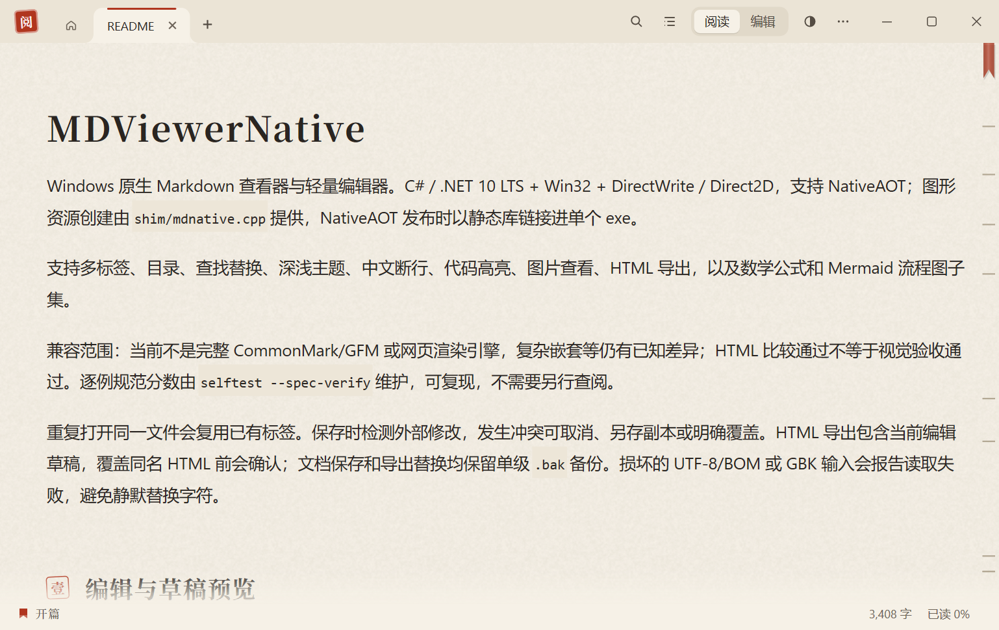
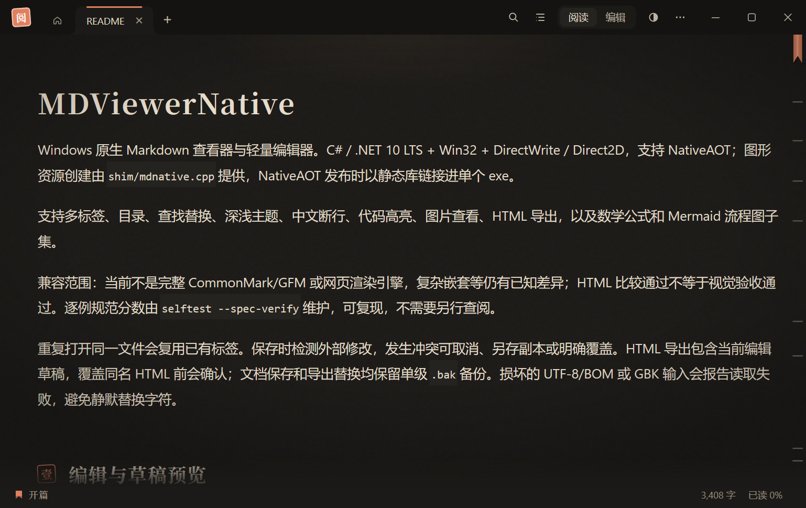

# MDViewerNative

Windows 原生 Markdown 查看器与轻量编辑器。C# / .NET 10 LTS + Win32 + DirectWrite / Direct2D，支持 NativeAOT；图形资源创建由 `shim/mdnative.cpp` 提供，NativeAOT 发布时以静态库链接进单个 exe。

支持多标签、目录、查找替换、深浅主题、中文断行、代码高亮、图片查看、HTML 导出，以及数学公式和 Mermaid 流程图子集。

## 界面

浅色「宣纸」与深色「灯下」两种纸面，同一份文档两种阅读氛围（截图取自本仓库 README）：

| 宣纸（浅色） | 灯下（深色） |
| --- | --- |
|  |  |

兼容范围：当前不是完整 CommonMark/GFM 或网页渲染引擎，复杂嵌套等仍有已知差异；HTML 比较通过不等于视觉验收通过。逐例规范分数由 `selftest --spec-verify` 维护，可复现，不需要另行查阅。

重复打开同一文件会复用已有标签。保存时检测外部修改，发生冲突可取消、另存副本或明确覆盖。HTML 导出包含当前编辑草稿，覆盖同名 HTML 前会确认；文档保存和导出替换均保留单级 `.bak` 备份。损坏的 UTF-8/BOM 或 GBK 输入会报告读取失败，避免静默替换字符。

## 编辑与草稿预览

源码编辑支持随深浅主题变化的 Markdown 着色，包括标题、列表/引用标记、强调/链接分隔符及代码。着色延迟更新，输入法组词期间暂停，不影响文本、撤销或保存状态；超过 100 万字符或 2 万个颜色片段时使用普通文字颜色。当前使用系统 RichEdit，位置与查找替换保持 UTF-16/CRLF 契约。

`Ctrl+E` 在源码编辑与只读预览之间切换。未保存内容可以直接预览，不会因此写入源文件；草稿仍可恢复，`Ctrl+S` 才提交保存。新增/切换标签保留各自草稿，关闭或替换现有文档仍有保存/放弃/取消保护。

同一文档在内容未被其他操作替换时往返预览，保留原生编辑区的选区、位置和撤销。跨标签通过每文档文本历史保留撤销/重做，并保留草稿、选区及编辑区首可见字符位置；不依赖转移原生控件的撤销栈。首次从阅读进入编辑、以及编辑返回预览，使用原始 UTF-16 块范围定位；列表和引用为容器级范围，合成内容按邻近块回退，不承诺段内字符级映射。

预览本身仍只读。“在渲染后的预览场景直接编辑”是未来用户可选的待选模式，本轮没有新增该模式的开关或实现。

## 阅读效率与中文输入

- 宽代码和表格可独立横向滚动，支持悬停滚轮、横向滚轮及左右方向键，包括列表中的块。表格首列在宽度适合时冻结；打印/PDF 中代码恢复折行、表格压缩，避免纸上丢失右侧内容。

- 代码块右键可整块复制；对代码定位后也可用键盘上下文菜单。复制保留内容 Tab、引号和末尾空行，支持列表内代码。
- `Alt+Left` / `Alt+Right` 后退、前进，也可使用上下文菜单。记录链接、目录与脚注跳转；失败不消耗历史，关闭的命名文档可以重新打开。
- 查找栏“选项”提供大小写、整词和正则表达式匹配。预览、编辑及两种替换共用规则；整词采用 Unicode 字母/数字/连接标点/组合字符边界，正则匹配有超时保护。
- 输入法正在组词时，先确认或取消候选再预览、保存、替换、切换或关闭。标题显示组合状态；跨实例打开请求会等组合结束后继续，不丢失队列。

## 界面与操作

工具栏采用 36 DIP 高度，保留暖白纸面、深灰背景与蓝色强调。多标签按可用空间显示，当前标签优先保留；标题单行省略，悬停可查看完整名称，右侧下拉列表可切换全部文档。同名文件在列表中显示完整路径。

阅读态查找覆盖在工具栏下方，开关不改变正文排版、视口高度和滚动位置；执行搜索时会按需滚动到匹配处。编辑态查找替换仍预留空间，避免遮住输入光标。两种模式均提供上一处、下一处和关闭按钮；替换行带独立输入提示。Tab 在查找控件间导航，Enter 查找或替换，Esc 关闭并回到正文。F6 聚焦工具栏，方向键选择、Enter 执行；再次 F6 返回正文。Ctrl+Tab / Ctrl+Shift+Tab 切换文档。

正文和编辑字号共用 Ctrl+= / Ctrl+- / Ctrl+0，编辑缩放保留选区和撤销记录。编辑区默认 16 DIP，并留出内边距；切换主题后内边距保持。目录覆盖在正文左侧，开关不重排正文、不改变窗口宽度；手动窄窗仍可使用，编辑模式中目录按钮灰显。点击目录条目或找到搜索结果后，目录自动收起以露出完整正文。阅读态按 Esc 先关闭查找，再关闭目录。低频操作按用途收拢：文档操作下分为标签、书签、导出与打印；恢复副本、历史版本、跳转历史与图片缓存放在“设置与维护 → 恢复、历史与缓存”。

## 构建与发布

正式入口为根目录 `build.ps1`，支持 Windows PowerShell 5.1 / PowerShell 7，可从其他工作目录调用。SDK 版本由 `global.json` 约束为 .NET 10.0.4xx，允许该系列的补丁更新。

```powershell
# 从源码重建原生 shim，再检查格式、自测、逐例规范和语料
./build.ps1 -Task Verify

# 仅编译；没有 C++ 工具链时可显式使用仓库内的 shim
./build.ps1 -Task Build -SkipNative

# 验证后生成 NativeAOT 程序与压缩包（程序、原生 DLL、第三方声明）
./build.ps1 -Task Publish

# 本机完整发布验收：额外运行真实性能和窗口交互检查
./build.ps1 -Task Publish -Performance -Ui

# 明确允许真实桌面输入及剪贴板保护测试（需保持测试窗口前台）
./build.ps1 -Task Publish -Performance -Ui -DesktopInput
```

使用已有的项目内隔离 SDK 时，无需手工修改 PATH：

```powershell
./build.ps1 -Task Verify -SdkDirectory work/maturity/sdk10
./build.ps1 -Task Verify -Performance -SdkDirectory work/maturity/sdk10
```

`-SdkDirectory` 指向包含 `dotnet.exe` 的 SDK 根目录；相对路径以项目根目录为准。脚本仍按 `global.json` 解析版本，在原生编译前检查 SDK；不会下载安装 SDK，也不会降低版本。显式选择 SDK 时临时设置的 SDK 相关进程变量，成功或失败后均恢复原值；CLI/NuGet 状态放在项目内 `work/maturity/`。不传此参数时使用原来的系统/CI SDK。该参数可与 Build、Publish 和自定义输出目录组合使用。

从源码构建和 NativeAOT 发布需要 Visual Studio C++ x64 工具链及 Windows SDK。脚本优先使用 `vswhere` 查找工具链，也支持未登记到安装器的标准安装目录；自定义安装可设置 `MDV_VCVARS_PATH`，指向 `vcvars64.bat`。无需新装第三方 NuGet 包，首次构建仍需要还原 .NET SDK/AOT 运行时包。

默认产物位于 `artifacts/`，可用 `-OutputDirectory` 指定其他目录。重建原生 shim 时会同步刷新仓库中的 `engine/MDNative.dll`，开发、自测和 JIT 运行使用它；编译与链接使用 `/Brepro`，源码和工具链不变时字节一致。NativeAOT 发布把 shim 以静态库链接进 exe，发布目录 `artifacts/publish/win-x64/` 只有一个程序文件，若残留 `MDNative.dll` 打包会直接失败。分发包为 `artifacts/MDViewerNative-win-x64.zip`，内含程序与 `THIRD-PARTY-NOTICES.txt`，解压即可运行；未做代码签名，首次启动需在 Windows SmartScreen 中选择“仍要运行”。旧 `aot_build.bat` 和 `engine/aot-publish.cmd` 转调统一入口。

`.github/workflows/ci.yml` 在 Windows 上执行 `build.ps1 -Task Verify`：格式、自测、逐例规范与语料基线；推送分支或发起 PR 时触发。NativeAOT 打包需要完整工具链，托管 runner 上 SDK 解析不到 ILC 编译器包（`PublishAot=true` 但 `IlcCompilerPath` 为空，发布会静默退回 JIT），因此发布包在本机生成；性能门槛与窗口检查依赖本机与交互桌面，同样在本机显式运行。

## 草稿恢复与日志

编辑后约 2 秒保存一次恢复副本，持续输入也会定期保存；UI 线程繁忙时会延后。副本包含当前原生编辑区草稿、原保存快照、编码和原磁盘版本，不自动写回源文件。异常退出后，下次启动可以恢复为未保存标签，支持未命名文档及多个标签。选择暂不恢复会保留副本；成功保存或明确放弃后只清理对应副本。

恢复后的普通保存仍检查外部修改；即使原文件已被其他程序改写，也不会因恢复而绕过冲突确认。恢复文件损坏时保留为 `.corrupt-*` 以供人工处理，其余有效副本仍可恢复；较新格式的副本会保留，供对应版本读取。

配置、草稿及日志统一位于 `%APPDATA%/MDViewerNative/`；设置 `MDV_CONFIG_DIR` 可整体隔离。恢复文件位于 `drafts/`，错误日志为 `app.log`，超过约 1 MiB 后轮换到 `app.log.1`。恢复副本是本机明文文件。草稿恢复不替代主动保存，崩溃前尚未完成快照的输入可能丢失。

## 验证与基线

统一入口会检查子进程退出码；任何自测、逐例规范、语料或发布失败都会中止。规范检查基于 `selftest/spec-baseline.tsv`，比较每个样例的 strict/loose/fail 状态并验证规范文本版本，避免“总分没变但部分样例退化”被掩盖。

`Verify` / `Publish` 使用 `dotnet format whitespace --verify-no-changes` 检查生产与自测源码，格式漂移会中止验证。修复格式可在项目根目录执行：

```powershell
dotnet format whitespace engine/MDViewerNative.csproj
dotnet format whitespace selftest/SelfTest.csproj
```

`.editorconfig` 规定四空格缩进；三个纯查表文件保留成组初始化排版，仍参与检查。自测通过 `ProjectReference` 引用实际生产程序集，不再手工链接并重新编译生产源文件。格式检查只约束空白排版，不能替代命名、职责和错误处理的代码审查。

项目说明与 `docs/` 下的设计与架构文档遵循 CI 的新增行空白检查，不使用行尾空格；需要硬换行时用显式 `<br>`。Markdown 测试语料可能有语义性行尾空格，不随文档整理批量清理。

专项诊断可从 `selftest` 目录运行：

```powershell
dotnet run -c Release -- --spec-verify
dotnet run -c Release --no-build -- --parser-isolation
dotnet run -c Release --no-build -- --perf
```

`--spec` 只输出项目归一化后的 CommonMark 对照分数，不代表完整规范兼容。修改解析规则确需变更基线时，显式执行 `--spec-record` 并审查逐例差异；日常验证不会刷新基线。语料基线同样由 `selftest/CorpusGolden.ps1 -Verify` 只读检查。

`-Ui` 顺序运行 22 组窗口脚本，包含阅读、文档操作、公式/图表、宽内容和源码着色回归，要求没有正在运行的 MDViewerNative。它们仅操作自己启动的进程和临时文档，强制终止测试进程后会等待退出，再开始下一份测试。均可传入 `-ExePath` 检查 AOT 产物；统一入口的截图写入 `artifacts/ui/`。宿主检查包括通过消息循环验证列表续行，以及图片窗口的绘制、缩放、拖动和关闭。真实键鼠与输入法检查在 `-DesktopInput`（5 组，需 `-AllowInput`）。

1.0.0 发布前的完整检查已通过：从源码重建原生 shim 后执行 `Verify`，格式检查、C# 自测 2700 余项、逐例规范基线与语料基线均通过（2026-10-13）。更早的 2026-09-26 本地 `Verify -Performance` 与窗口套件（`-Ui` 22 组 447 项、`-DesktopInput` 5 组、高对比度，96 DPI）均通过。界面检查覆盖多标签溢出、窄窗、查找区键盘导航、主题切换和编辑缩放。共享绘图资源、编辑控件与图片窗口各自管理原生资源生命周期，解析、预览和导出共用内容模型。

当前架构、资源所有权及验证记录见 [ARCHITECTURE.md](ARCHITECTURE.md)。成熟解析器的实测与迁移条件见 [PARSER-EVALUATION.md](PARSER-EVALUATION.md)。

## 发布与校验

发布入口额外生成 ZIP 的 `.sha256` 和 `.manifest.json`，校验包内文件与发布目录逐字节哈希一致，记录源码提交、工作区是否有修改以及各项检查是否执行。未执行检查标为 `not-run`，不能视为通过。正式发布要求干净源码和完整验收；失败的发布尝试会清理旧候选包，避免误用上次产物。

跨显示器 DPI 和真实输入法验收仍需单独完成。跨实例打开采用逐条确认的 Windows COPYDATA 与有界内存队列，不再共享单个临时路径文件；确认表示路径已接收，不保证随后打开成功，超时会提示重试。升级前应退出旧版本。

## 公式与图表子集

公式/图表现支持有界分数、双上下标、索引根式，以及 TD/TB/BT/LR/RL 流程图（含重试回路、自环等带环的图）、链式连线；不支持的语法保留源码。

## 许可与第三方组件

本项目以 [MIT 许可证](LICENSE) 发布。发布包内附 `THIRD-PARTY-NOTICES.txt`，列出随程序分发的第三方组件及其许可声明。
